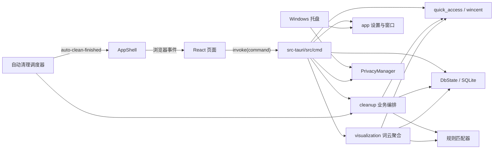

# Scourgify 项目快速上手

> 最后核对：2026-08-31
>
> 适用分支：`main`
>
> 代码核对基线：当前工作区。
>
> 当前应用元数据版本：`0.8.0`。

## 1. 项目是什么

Scourgify 是一个仅支持 Windows 的 Tauri 2 桌面工具，用于管理 Windows Explorer Quick Access：

- 在数据中心查看 Recent Files、Frequent Folders、清理统计和访问/清理词云。
- 在 Recent/Frequent 明细中按名称和路径筛选、按最后使用时间排序，并可选用 DestList 深度解析查看不可见项目。
- 控制 Recent、Frequent 和 Windows 11 Start Recommended 的可见性。
- 使用白名单保护路径、使用黑名单标记待清理路径。
- 执行手动或自动 Smart Clean，并记录历史和统计。
- 通过持有 Windows Quick Access 锁提供隐私模式。
- 以 Dashboard、九宫格或仅托盘三种模式运行。

底层 Windows Quick Access 操作由 Rust 依赖 `wincent 0.2.6` 完成。项目不会在非 Windows 平台编译。

## 2. 技术栈

| 层 | 主要技术 |
| --- | --- |
| 桌面壳 | Tauri 2 |
| 前端 | React 19、TypeScript 5.8、Vite 7 |
| UI | Tailwind CSS 4、shadcn、Base UI、Lucide、next-themes |
| 表格和可视化 | TanStack Table、`@visx/wordcloud` |
| 表单和校验 | React Hook Form、Zod |
| 国际化 | i18next、react-i18next、五份 JSON 语言资源 |
| Rust 数据层 | rusqlite，内置 SQLite；Debug Mock 使用 `fake` 生成测试数据 |
| Windows 集成 | wincent、winreg |
| 持久化 | `config.json`、`scourgify.db` |

## 3. 目录地图

```text
.
├─ src/                         React 前端
│  ├─ App.tsx                  Hash Router 和页面路由
│  ├─ main.tsx                 ThemeProvider、I18nProvider 和 React 入口
│  ├─ components/
│  │  ├─ AppShell.tsx          导航、共享配置、应用级事件
│  │  ├─ TitleBar.tsx          无边框窗口控制和 Dashboard/Grid 切换
│  │  ├─ Dashboard.tsx         数据中心、摘要卡片和明细弹窗
│  │  ├─ dashboard/            数据中心词云组件
│  │  ├─ RulesPage.tsx         白名单/黑名单管理
│  │  ├─ HistoryPage.tsx       清理历史、筛选和导出
│  │  ├─ MockTestPage.tsx      仅开发环境的 Mock Lab
│  │  ├─ SettingsPage.tsx      全量设置
│  │  └─ ConfigDrawer.tsx      外观和可见性快捷设置
│  └─ lib/
│     ├─ config.ts             前端配置 Schema
│     ├─ commands.ts           Tauri invoke、结构化错误和本地化消息
│     ├─ app-events.ts         浏览器内部事件
│     ├─ i18n.ts               i18next 初始化和 Tauri 语言事件桥接
│     ├─ i18n/*.json           五语言前端文案
│     └─ notifications.ts      前台操作系统通知
├─ src-tauri/
│  ├─ src/
│  │  ├─ app/                  启动、托盘、窗口、主题、调度、通知
│  │  ├─ cmd/                  Tauri IPC 命令适配层
│  │  ├─ cleanup/              清理用例与自动清理编排
│  │  ├─ config/               JSON 配置加载与保存
│  │  ├─ db/                   SQLite 状态、迁移、规则仓储与历史数据
│  │  ├─ mock/                 仅 Debug 的 Quick Access Mock 与控制指令
│  │  ├─ privacy/              Quick Access 隐私锁与写操作并发门
│  │  ├─ quick_access/         外部边界、wincent 操作、缓存、监控与 DTO
│  │  ├─ rules/                规则模型、匹配语义与导入导出
│  │  ├─ visualization/        词云分词、聚合、权重和数据范围
│  │  ├─ error.rs              结构化 IPC 错误、告警与 incident ID
│  │  ├─ lib.rs                Rust crate 入口与模块声明
│  │  └─ main.rs               桌面进程入口
│  ├─ capabilities/            主窗口允许使用的 Tauri 权限
│  └─ tauri.conf.json          Tauri 窗口、CSP 和 MSI 配置
├─ docs/planning/              各版本规划文档，不是运行时代码
└─ reference/                  外部参考项目，不参与 Scourgify 构建
```

阅读时应先忽略 `reference/`，从 `src/main.tsx`、`src/App.tsx` 和 `src-tauri/src/app/mod.rs` 开始。

## 4. 运行时架构



前端不直接调用 Windows API。所有系统能力都通过 Tauri Command 进入 Rust。前端调用统一经过 `src/lib/commands.ts`，不在组件中直接使用 Tauri `invoke()`。

## 5. 启动流程

Rust 入口为 `src-tauri/src/main.rs`，实际构建过程在 `src-tauri/src/app/mod.rs`：

1. 注册日志、文件对话框、通知、系统信息、打开器、开机启动和单实例插件。
2. 注册 `src-tauri/src/cmd/mod.rs` 中的 IPC 命令。
3. 执行 `app/setup.rs::initialize`：
   - 读取或创建 `config.json`。
   - 将配置中的开机启动状态与系统实际状态同步。
   - 打开并迁移 `scourgify.db`。
   - 创建 `PrivacyManager`，必要时恢复隐私模式。
   - 将配置、数据库、Quick Access Backend、缓存、隐私管理器和自动清理状态放入 Tauri State。
   - 启动定时调度器、monitor 模式触发器，以及 Recent/Frequent 两个 Quick Access 监控器。
   - Quick Access 监控器通过 `wincent` 每三秒轮询，更新缓存并在发现新增项时触发 monitor 自动清理。
   - 安装主窗口关闭事件处理，再根据 Dashboard/Grid/Tray 模式显示、调整或隐藏主窗口。
   - 创建托盘，设置当前窗口图标，并启动每三秒一次的 Windows 系统主题图标检查。

单实例插件会阻止第二个实例。Dashboard/Grid 模式下再次启动会聚焦对应主窗口；Tray 模式下显示“已经运行”提示。

前端启动时，`src/main.tsx` 会先挂载 `ThemeProvider` 和 `I18nProvider`。`I18nProvider` 读取当前语言并监听后端语言变更；`AppShell` 读取配置后将 `system/light/dark` 应用到 WebView，并监听自动清理完成事件。

## 6. 前端页面

### Dashboard / 数据中心

`src/components/Dashboard.tsx` 是数据中心首页：

- 顶部四张摘要卡分别显示最近文件、常用文件夹、永久累计清理总量和自动清理状态；点击整张卡片打开对应明细或设置弹窗。
- 深度解析关闭时，最近文件和常用文件夹卡片只显示当前可见数；开启后显示“可见数/DestList 解析数”，解析失败时分母显示 `--`。
- 最近文件和常用文件夹弹窗默认按最后使用时间倒序显示。名称和路径使用彼此独立的列头关键词筛选，日期列可切换升降序。
- 深度解析关闭时弹窗调用 `list_qa_items`，只展示当前可见项目；开启后再调用 `list_qa_item_metadata`，按路径合并 DestList metadata 和可见项目，并增加“是否可见”列及全部/可见/隐藏筛选。
- DestList 解析失败不会丢弃已经读到的可见项目，弹窗会保留基础列表并显示错误提示。
- 已清理卡片打开最近清理记录弹窗，固定每页 10 条；自动清理卡片可直接选择禁用、每隔若干小时、每天定时或 monitor 模式，并显示下次运行时间或倒计时。
- 右下角浮动按钮依次对 Recent 和 Frequent 执行 Smart Clean，并遵循 `smart_clean_confirm` 确认偏好。
- 中部词云根据可视化偏好选择“最近访问/最近清理”和“近 7 天/近 30 天/所有时间”，默认使用“最近访问 + 所有时间”；词云本身不显示数据源、范围标题或切换工具栏。
- 访问词云在深度解析关闭时只使用当前可见项目，开启后使用 DestList metadata，并按 `last_interaction_at` 应用范围筛选；清理词云按 `cleaned_at` 应用范围筛选，只分析选定范围内 `visible=1` 的历史记录。
- 词云在 Rust 本地完成混合语言分词、规则标记、权重计算和前 40 词聚合，前端只接收聚合词条，不接收原始路径集合。清理数据最多读取 20,000 条，并在截断时提示。

### Rules

`src/components/RulesPage.tsx` 提供规则 CRUD、启停、字段筛选、分页和跨页选择，并支持规则数据导入、导出及批量清理。导入支持预览后选择部分规则，导出和清理支持全部规则或当前选中规则。规则写操作要求：

- 数据库可用。
- 隐私模式未激活。

页面会提示同一个关键词同时存在于白名单和黑名单，但不会禁止保存。

### History

`src/components/HistoryPage.tsx` 使用 TanStack Table 和服务端分页、排序：

- 固定每页 10 条，默认按清理时间倒序，可切换时间排序方向。
- 通过列头筛选路径关键词、Recent/Frequent 类型、手动/自动来源和规则命中状态。
- 在操作列中持久隐藏、恢复或删除单条清理记录，并可清空全部记录。
- 右下角 CSV 导出始终导出全部记录，包括已隐藏记录。
- 路径筛选在服务端查询刷新期间保持输入焦点和菜单打开状态。

历史清空在隐私模式下仍可执行；永久累计统计不会随明细历史清空而重置。

### Mock Lab

`src/components/MockTestPage.tsx` 仅在 Vite 开发环境注册为 `/mock` 路由，生产构建不会加载该页面。它通过 Debug IPC 控制独立的 Mock Quick Access 后端和数据库，用于在不修改真实 Windows Quick Access 数据的前提下验证界面和事件行为：

- 切换 Mock 模式，选择预置场景，刷新或重置模拟数据。
- 生成规则及清理历史，每次生成数量限制为 1 至 1000 条，并可触发测试事件。
- 通过生产词云命令显式覆盖数据源和范围，验证访问热点以及 7 天/30 天清理热点；Quick Access Mock 包含可断言的多语言重复主题。命令本身还支持所有时间，当前 Mock Lab 下拉框未暴露该选项。
- 清理历史使用 Windows 风格路径；路径词汇覆盖英文、简体中文、繁体中文、法语和俄语。
- 时间由 `fake` 生成，范围为当前时间向前一年内；部分来源规则关键词从生成路径中提取。

Mock 控制命令仅在 Debug 构建注册，并且必须先启用 Mock 模式才能操作模拟数据。

### Settings

`src/components/SettingsPage.tsx` 管理：

- Dashboard/Grid/Tray 模式、语言、开机启动和关闭行为；修改模式会立即切换窗口布局。
- 下次启动时是否恢复隐私模式。
- `system/light/dark` 主题，保存后由 `next-themes` 立即应用。
- 可视化深度解析开关。只有启用后，数据中心和访问词云才可读取 DestList metadata；设置项自身不显示额外说明文案。
- 词云数据源“最近访问/最近清理”和数据范围“近 7 天/近 30 天/所有时间”；默认分别为 `recent_access` 和 `all_time`。
- 是否在词云中显示黑名单词条。
- Quick Access 和 Start Recommended 可见性。
- 系统通知策略。
- 危险操作和 Smart Clean 确认偏好。
- 清空程序日志和已记录的清理历史。
- 查看版本、作者、许可证和 GitHub，并打开日志目录。

设置页没有单独的“保存”按钮；表单变更经 300 ms 去抖后串行调用 `update_config`。Recent/Frequent/Start Recommended 可见性会立即写入 Windows，失败时回读实际状态。

解锁隐私模式时始终尝试清理锁定期间新增的 Recent `.lnk`；单项删除为 best-effort，失败项通过 report/warning 返回且不阻止解锁完成。清理历史始终无限保留。这两项不再由设置页配置。自动清理计划由后端配置和调度器支持，当前入口位于数据中心的自动清理摘要卡弹窗，而不是 Settings。

`ConfigDrawer.tsx` 是主题和 Quick Access 可见性的快捷入口。

Dashboard 和 Grid 共享 `TitleBar.tsx` 提供最小化、最大化、关闭和两种窗口模式的快速切换。关闭时，Rust 会按 `close_behavior` 决定隐藏到托盘还是真正退出。

## 7. IPC 命令分组

注册表位于 `src-tauri/src/cmd/mod.rs`。

| 分组 | 主要命令 |
| --- | --- |
| 应用配置 | `get_config`、`update_config`、`get_app_mode`、`set_app_mode`、`current_language`、`hide_about` |
| 隐私模式 | `privacy_enter`、`privacy_exit`、`privacy_state` |
| 数据库 | `get_database_status`、`retry_database`、`open_database_directory` |
| 运行状态 | `get_runtime_status` |
| 规则 | `get_rules`、`add_rule`、`update_rule`、`remove_rule`、`toggle_rule`、`clear_rules`、`export_rules`、`preview_rules_import`、`import_rules` |
| Quick Access | `list_qa_items`、`get_qa_counts`、`list_qa_item_metadata`、`add_qa_item`、`restore_qa_defaults`、`get/set_qa_visibility`、`open_in_explorer` |
| Dashboard 可视化 | `get_dashboard_word_cloud`（数据中心显式传入当前数据源、范围、深度解析和黑名单偏好；参数省略时兼容读取已保存偏好，Mock Lab 可只覆盖数据源和范围） |
| 清理 | `list_qa_items_classified`、`remove_qa_items`、`empty_qa_items`、`smart_clean`、`run_auto_clean_now` |
| 历史和统计 | `get_clean_records`、`get_cleanup_runs`、`export_clean_records`、`export_cleanup_runs`、`clear_clean_records`、`remove_clean_record`、`set_clean_record_visibility`、`restore_hidden_clean_records`、`get_stats` |
| 九宫格摘要 | `get_grid_summary` |
| Debug Mock | `get/set_mock_mode`、`set_mock_scenario`、`refresh/reset_mock_data`、`generate_mock_rules`、`generate_mock_history`、`trigger_mock_event` |
| 系统打开和诊断 | `get_log_directory_status`、`open_log_directory`、`clear_program_logs` |

`cmd` 层只负责参数、Tauri State、统一权限检查、成功 DTO 和结构化错误转换；业务逻辑位于对应领域模块。

所有命令返回 `CommandResult<T> = Result<T, CommandError>`。查询和批处理返回各自领域 DTO，原本没有返回值的副作用操作返回：

```text
ActionReceipt { action, target, affected }
```

IPC 错误统一包含：

```text
CommandError { code, message, retryable, incident_id }
```

- `code` 是稳定的机器可读错误码，前端可据此选择本地化文案。
- `message` 是不包含本地路径和底层错误链的安全后备消息。
- `retryable` 表示重试是否可能有意义。
- `incident_id` 同时出现在本地日志中，用于关联用户反馈和完整错误链。

内部基础设施错误继续使用 `anyhow` 添加上下文；需要由调用方区分的正常业务错误使用小型 `thiserror` 枚举。禁止通过解析用户可见错误字符串决定业务分支。

## 8. 规则与清理语义

规则匹配位于 `src-tauri/src/rules/matcher.rs`：

1. 将路径和关键词转为小写，做子串匹配。
2. 忽略禁用或空关键词规则。
3. 先检查白名单，再检查黑名单。
4. 同一类型多条命中规则中，取 `id` 最小的一条。

分类结果：

| 状态 | 含义 |
| --- | --- |
| `protected` | 命中白名单，任何规则感知清理都跳过 |
| `targeted` | 命中黑名单，是 Smart Clean 目标 |
| `neutral` | 未命中规则 |

清理行为：

- 删除选中项、清空当前分类：删除所有非 protected 项。
- Smart Clean：只删除 targeted 项。
- 输入路径会按不区分大小写去重。
- Windows 删除采用批量结果，允许部分成功。
- 仅成功删除的路径写入历史。
- targeted 项会保存 `rule_id` 和 `rule_keyword` 快照。
- 历史写入失败不会撤销已经完成的 Windows 删除，而是在结果中返回 `history_error`。

## 9. 隐私模式

`src-tauri/src/privacy/mod.rs` 使用 `wincent::QuickAccessLock`：

- 优先锁定全部 Quick Access。
- 完整锁失败后分别尝试锁定 Recent 和 Frequent。
- 降级锁失败会按目标保留在本地诊断中；只要至少一个目标锁定成功，命令仍返回 partial 状态及安全 warning。
- Recent 和 Frequent 两者都失败时才返回错误，错误日志会保留完整锁与两个分目标锁的失败链。
- 解锁时始终尝试删除锁定期间新增的 Recent `.lnk`；删除为 best-effort，失败项通过 report/warning 返回，不阻止解锁完成。

隐私模式激活后，Rust 命令层会拒绝以下操作：

- Quick Access 删除、清空、Smart Clean。
- 添加项目、恢复默认项、修改可见性。
- 规则新增、修改、启停和删除。
- 自动清理。

浏览、统计、历史查询和导出仍可执行。实际隐私模式的即时开关目前主要位于托盘；Settings 中的开关表达的是下次启动恢复偏好。

## 10. 自动清理

`src-tauri/src/app/scheduler.rs` 启动独立线程，支持：

| 类型 | 行为 |
| --- | --- |
| `disabled` | 等待重新配置 |
| `monitor` | Quick Access 检测到新增项后执行 |
| `every_hours` | 每 1 至 168 小时运行 |
| `daily_at` | 按本地时间每天运行 |

一次自动清理会按顺序对 Recent 和 Frequent 执行 Smart Clean。运行前检查：

- 数据库必须可用。
- 隐私模式必须关闭。
- 不允许两个自动清理并发运行。

完成后会：

1. 更新 `auto_clean_last_run` 并保存配置。
2. 根据结果和窗口活跃状态发送系统通知。
3. 发出 Tauri `auto-clean-finished` 事件。
4. `AppShell` 转发为浏览器内部事件，刷新 Dashboard 和 History。

## 11. 配置和数据

### config.json

位置由 Tauri `app_config_dir` 决定。首次启动自动创建，旧配置缺失字段时由 Serde 默认值补齐。

主要字段：

- `app_mode`、`language`、`auto_start`。
- `privacy_mode`、`privacy_mode_cleanup_links`。
- `close_behavior`、`theme`。
- `show_recent_files`、`show_frequent_folders`。
- `visualization_deep_parse`、`visualization_data_source`、`visualization_data_range`、`word_cloud_show_blacklist_terms`。
- 通知和确认偏好。
- `history_retention`。
- `auto_clean`、`auto_clean_last_run`。

前端 `src/lib/config.ts` 和 Rust `src-tauri/src/config/mod.rs` 分别维护同一份结构及校验边界。修改字段时必须同步检查两端。

### scourgify.db

SQLite schema 当前为 v5：

- `rules`：关键词、类型、启用状态、创建时间。
- `clean_records`：实际成功清理的路径、项目类型、规则快照、来源、所属运行、时间和列表可见性；`visible=0` 的记录不在历史页面显示，但仍参与统计和全量导出。
- `cleanup_runs`：操作、触发来源、范围、状态、成功/失败/保护/警告统计和 incident ID。
- `cleanup_totals`：不受明细裁剪和清空影响的永久累计条目及运行统计。

v1 首次建库会加入 `Desktop`、`Documents` 两条内置白名单。删除后不会重新补种。

删除规则时，历史记录的 `rule_id` 会因外键变为 null，但 `rule_keyword` 快照保留。

`history_retention` 固定归一化为 `0`，表示无限保留清理明细和操作记录；用户仍可在 Settings 的“清理”组手动清空这些记录，但不会减少 `cleanup_totals`。

## 12. 数据库降级

`DbState` 即使初始化失败也会被注册到 Tauri State，而不是让应用退出。

数据库不可用时：

- Quick Access 基础浏览、计数和 Explorer 操作仍可用。
- 规则分类、规则 CRUD、规则感知清理、历史和统计不可用。
- 数据中心的访问词云仍可从 Quick Access 生成，但黑名单标记不可用时会返回 warning；清理词云和清理统计依赖数据库。
- Rules 和 History 页面显示数据库恢复面板，展示路径与根因摘要并允许原地重试；数据中心本身不渲染该面板。

重试成功后复用当前 `DbState`，不需要重启应用。

## 13. 通知与事件

前台手动操作的通知由 `src/lib/notifications.ts` 发出；后台自动清理由 Rust `app/notifier.rs` 发出。

| 事件 | 来源 | 用途 |
| --- | --- | --- |
| `language-changed` | Rust | 更新前端语言 |
| `quick-access-changed` | Rust | Quick Access 缓存变化及 revision |
| `auto-clean-finished` | Rust | 自动清理完成及结果摘要 |
| `scourgify:refresh-dashboard` | 前端 | 刷新 Dashboard |
| `scourgify:refresh-history` | 前端 | 刷新 History |
| `scourgify:open-config-drawer` | 前端 | 打开外观抽屉 |
| `scourgify:auto-clean-updated` | 前端 | 转发自动清理结果给同一 WebView 内的消费者 |

Tauri 事件跨 Rust/WebView；`scourgify:*` 是同一 WebView 内的 `CustomEvent`。

## 14. 当前实现边界

- `confirm_destructive_actions` 可保存，但当前数据中心没有普通删除、清空或恢复默认操作入口，因此该偏好尚未在数据中心消费；`smart_clean_confirm` 已生效。
- WebView 的 `theme` 会跟随应用偏好，但原生托盘和窗口图标始终按 Windows 系统主题切换，不跟随应用内强制的 light/dark 选项。
- `close_behavior=hide` 只拦截 `main` 窗口的关闭请求；`quit` 不拦截，由 Tauri 执行默认关闭。

其他需要注意的边界：

- `privacy_mode_cleanup_links` 是兼容旧配置保留的字段，加载和保存时固定归一化为 `true`。
- `clean_records.run_id` 仍保留与 `cleanup_runs` 的后端关联；History 页面当前只展示清理条目，不提供操作历史视图。
- `list_qa_item_metadata` 只有在 `visualization_deep_parse=true` 时才允许调用；关闭时 Rust 返回结构化校验错误，而不是读取 DestList。
- `list_qa_items_classified`、Quick Access 添加/删除/清空/恢复默认等 IPC 仍在 Rust 注册，但当前 Dashboard/Grid 页面没有对应的直接操作入口。
- Dashboard 的清理总量来自永久累计。可视化偏好默认使用“最近访问 + 所有时间”；深度解析启用后，最近文件和常用文件夹计数显示为“可见数/DestList 解析数”，弹窗列表可按名称和路径两个独立列筛选、按日期排序，并可筛选可见性。DestList 解析失败时保留可见项目。清理词云只分析选定范围内的可见历史。
- 数据中心词云没有可见的数据源/范围标题或分割工具栏；设置页是唯一的持久化选择入口，Mock Lab 可以通过 IPC 参数临时覆盖。
- `show_recent_files` 和 `show_frequent_folders` 同时存在于配置和 Windows 实际状态中。页面打开时以 Windows 状态为准，再同步进表单。

这些是当前代码行为说明，不代表已经确认的后续需求。

## 15. 日志与错误排查

release 日志写入 Tauri `app_log_dir`，文件名前缀为 `scourgify`，单个文件上限 1 MB，保留最近 10 个轮转文件。Settings 的 About 区域可直接打开日志目录，“清理”组可截断当前日志并删除已轮转日志。

命令失败时，优先使用前端错误消息末尾的 `incident_id` 搜索日志。典型日志格式：

```text
operation=smart_clean code=QuickAccessOperationFailed incident_id=... error=完整错误链
```

- IPC 只返回安全消息；路径、SQLite、IO、Tauri 和 wincent 等底层信息仅保留在本地日志。
- 预期业务拒绝记录为 `warn`，不可预期的系统或数据故障记录为 `error`。
- 后台自动清理、启动隐私恢复和 panic 同样生成 incident ID。
- panic hook 会记录线程、源码位置和 panic payload，然后继续调用默认 hook。

## 16. 最快阅读路径

首次接手建议按以下顺序阅读：

1. `README.md`、`package.json`、`src-tauri/Cargo.toml`。
2. `src/App.tsx` 和 `src/components/AppShell.tsx`。
3. 选择一个页面，查看其中的 `invokeCommand(...)`，再阅读 `src/lib/commands.ts` 理解统一错误处理。
4. 在 `src-tauri/src/cmd/mod.rs` 找到命令注册。
5. 进入对应 `cmd/*.rs`，再进入领域模块。
6. 规则与清理相关继续阅读 `rules/mod.rs`、`rules/matcher.rs`、`cleanup/mod.rs`。
7. 数据相关继续阅读 `db/migrations.rs`、`db/rule_repository.rs`、`db/history/mod.rs` 和 `db/history/runs.rs`。
8. 最后阅读 `app/tray.rs`、`app/window.rs`、`app/theme.rs` 和 `app/scheduler.rs` 理解后台与窗口行为。

一条典型调用链：

```text
Dashboard.loadOverview
  -> invokeCommand("get_qa_counts") + invokeCommand("get_stats")
  -> Tauri invoke -> cmd/quick_access.rs / cmd/history.rs
  -> QuickAccessCache / db::stats
  -> summary cards + refresh

Dashboard.runSmartClean
  -> invokeCommand("smart_clean") for recent and frequent
  -> cmd/cleanup.rs::smart_clean
  -> cleanup/mod.rs::smart_clean
  -> matcher::classify
  -> QuickAccessBackend::remove_items
  -> wincent / Windows
  -> db::history::insert_batch
  -> QaBatchResult
  -> Toast + system notification + refresh
```

## 17. 本地验证命令

```powershell
pnpm install
pnpm build
cargo check --manifest-path src-tauri/Cargo.toml
cargo test --manifest-path src-tauri/Cargo.toml
pnpm tauri dev
pnpm tauri build
```

- Vite 开发端口固定为 `1420`。
- Tauri 构建目标是 Windows MSI。
- MSI 输出位于 `src-tauri/target/release/bundle/msi/`。
- `pnpm build` 会更新 `dist/`，Rust 命令会写入 `src-tauri/target/`；只读排查时不必运行。

## 18. 修改前检查

- Windows 写操作是否仍经过 `cmd/mod.rs::begin_quick_access_write` 的 `QuickAccessWritePermit` 门。
- 新配置字段是否同时更新 Rust、TypeScript Schema 和默认值。
- 新 Tauri 命令是否注册到 `cmd/mod.rs`。
- 新命令是否返回明确成功 DTO，并在失败时生成结构化 `CommandError`。
- 前端是否通过 `invokeCommand()` 调用，而不是直接使用 Tauri `invoke()`。
- 用户可见错误是否避免暴露本地路径，并能通过 incident ID 关联完整日志。
- 清理行为是否保持白名单优先和成功后才记历史。
- 数据库失败时是否仍能维持基础 Quick Access 浏览。
- 自动清理是否继续受数据库、隐私模式和并发保护。
- 新后台结果是否需要触发 Dashboard/History 刷新。
- 是否误改了 `reference/` 中的参考项目，而不是 Scourgify 主体。
